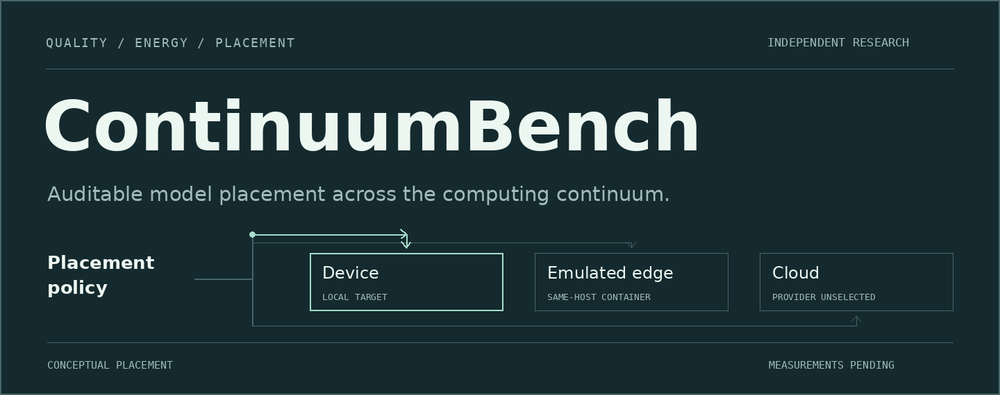

<p align="center">
  
</p>

<p align="center">
  <a href="#quick-start">Run the foundation</a> &nbsp;·&nbsp;
  <a href="#what-is-tested">Inspect the evidence</a> &nbsp;·&nbsp;
  <a href="#the-measurement-plan">Explore the plan</a> &nbsp;·&nbsp;
  <a href="docs/assets/readme/hero-static.png">View still artwork</a>
</p>

# Measure before you place

ContinuumBench prepares an auditable way to compare model placement across a local device, an emulated edge tier and a future cloud tier. **Quality, latency, energy and data boundaries stay separate**, so a placement decision can be inspected instead of compressed into an unexplained score.

**Python 3.12** · **Energy provenance** · **Constraint-aware routing** · **uv lockfile**

> **Current scope:** an independent systems research foundation. Tests use synthetic fixtures. No model benchmark, Mac power measurement, pilot or confirmatory result exists yet.

## What is tested

<table>
<tr>
<td width="50%" valign="top">
<h3>Measurement with provenance</h3>
<p>Bracketed power samples are integrated over a request window. Missing intervals and invalid baseline subtraction fail visibly. Measured, estimated and synthetic energy remain distinct.</p>
<p><a href="src/continuum_bench/energy.py">Energy library</a> · <a href="docs/method.md">Measurement method</a></p>
</td>
<td width="50%" valign="top">
<h3>Placement with boundaries</h3>
<p>Prototype policies check quality, latency and data-boundary constraints using prior estimates. Unknown sovereignty evidence stays unknown; held-out quality is not an oracle input.</p>
<p><a href="src/continuum_bench/routing.py">Routing policies</a> · <a href="src/continuum_bench/sovereignty.py">Proposed instrument</a></p>
</td>
</tr>
</table>

| Evidence as of 14 October 2026 | What it establishes |
| :--- | :--- |
| **33 passing software tests** | Tested calculations and boundaries at the [verified milestone commit](https://github.com/Agent007repo/continuum-bench/actions/runs/38505383446). |
| **Hosted quality and secret-scanning gates passed** | Locked installation, lint/format, strict typing, tests, derived consistency and documentation checks. |
| **Synthetic fixtures only** | Engineering verification. These checks establish no model quality, energy saving or Mac performance. |

[Software evidence](results/raw/software-checks/) · [Scenario tests](tests/scenarios/) · [Current status](STATUS.md)

## Quick start

Use Python 3.12 and `uv` from the repository root:

```bash
make setup          # Sync the committed lockfile
make test           # Lint, format, strict typing, tests and integrity
uv run cbench smoke # Write a clearly labelled synthetic pipeline record
make analyze        # Regenerate the current evidence inventory
```

The smoke command loads no model and measures no energy. It writes under `results/local/`. Full collection remains blocked by `make bench-full`; the foundation has no enabled paid provider.

<details>
<summary><strong>Documentation and report commands</strong></summary>

```bash
make docs            # Build the documentation with strict checks
make report          # Build the existing LaTeX report skeleton
make bench-smoke     # Run synthetic scenario checks
```

`make report` requires a LaTeX installation. The report is currently a one-page skeleton, not a completed research paper.

</details>

## The measurement plan

The [original pre-pilot draft](PREREGISTRATION.md) is retained unchanged and is **not frozen for full experiments**. After a disjoint pilot, a new immutable v1 must fix sources, artifacts, thresholds and analysis before confirmatory collection.

| Tier | Proposed role | Evidence boundary today |
| :--- | :--- | :--- |
| **Device** | Native inference on the user-reported M1 Max / 64 GB Mac | Hardware preflight, metering adapter and model feasibility pending |
| **Emulated edge** | A constrained container on the same host | Docker and network emulation unverified; no independent edge hardware |
| **Cloud** | A later remote comparison | Provider, residency, retention and energy uncertainty sources unselected |

Component power is not wall-plug energy. Remote energy cannot be presented as a local measurement. A provider's name or headquarters does not establish where a request is processed or retained.

### Materials and protocol decisions

The [dated shortlist](docs/protocols/2026-10-14-shortlist.md) records six owner-card model candidates. Two upstream revisions are pinned; full licence checks, converted weights, quantization, tokenizer hashes and all local suitability remain incomplete.

SQuAD is a general QA control candidate. XSum is excluded pending rights verification. The digital-industries, automotive and healthcare evaluation corpora remain unselected, and no external data or weights have been imported. Exact candidate states are preserved in the [inventory](configs/2026-10-14-shortlist.json).

The [pre-pilot decisions](docs/protocols/2026-10-14-pre-pilot-decisions.md) specify proposed split, thermal-order, metering and routing boundaries. Practical energy-reduction and quality-loss thresholds remain unset. The [Mac runbook](docs/RUNBOOK_full_benchmark.md) begins with read-only preflight; it contains no claim of completed hardware validation.

## Open the project

| Start with | Then explore |
| :--- | :--- |
| [Research questions](docs/research-questions.md) and [method](docs/method.md) | [Energy](src/continuum_bench/energy.py), [routing](src/continuum_bench/routing.py) and [runners](src/continuum_bench/runners.py) |
| [Reproduction guide](docs/reproduce.md) | [Tests](tests/), [raw evidence](results/raw/) and [derived artifacts](results/derived/) |
| [Status](STATUS.md) and [limitations](docs/limitations.md) | [Source register](docs/sources.json), [related work](docs/related-work.md) and [report skeleton](paper/report.tex) |

## Authorship and reuse

AI coding assistants prepared code, documentation and original README artwork from Samarth's research brief. Samarth's Mac measurements, calibration labels, design review and final wording review remain pending. The sovereignty instrument is proposed, not a legal determination.

This independent project has no affiliation with or endorsement from TU Delft, TU/e, TNO, f-inference or LLM4LM. It uses no internal material. Code is under [Apache-2.0](LICENSE); documentation is under [CC BY 4.0](LICENSE-docs). External material retains its own terms, recorded in [THIRD_PARTY.md](THIRD_PARTY.md).

---

**Companion project:** [TrustTrace](https://github.com/Agent007repo/trusttrace) follows stakeholder concerns into architectural evidence. Neither project supplies measured cross-project results yet.

<sub>The cover illustrates potential placement paths and stops after two animation cycles. It contains no measurement data. [Artwork source and rendering notes](tools/readme-art/README.md).</sub>
