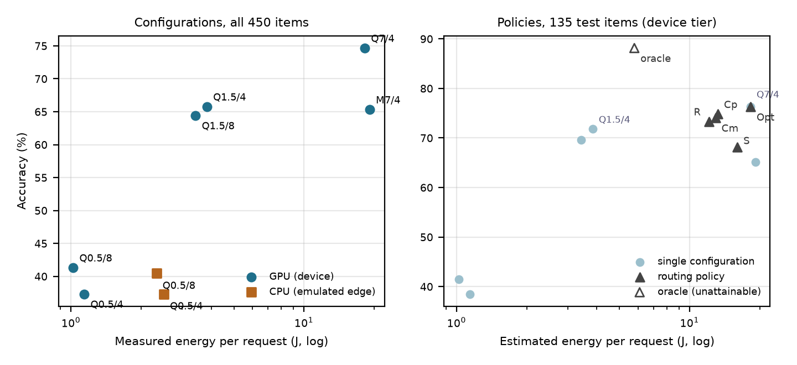

<p align="center">
  
</p>

<p align="center">
  <a href="#results">Results</a> &nbsp;·&nbsp;
  <a href="#quick-start">Reproduce the analysis</a> &nbsp;·&nbsp;
  <a href="paper/report.pdf">Read the report</a> &nbsp;·&nbsp;
  <a href="#limitations">Limitations</a>
</p>

# Measure before you place

ContinuumBench asks a practical question for small and medium-sized organisations that want to run language models under their own control: **how much accuracy, latency and energy does each placement and model choice cost, and can a router save energy without losing much accuracy?** Quality, latency, energy and data-control evidence are kept separate so the trade-off stays visible instead of being folded into one score.

The study ran on one MacBook Pro (Apple M1 Max, 64 GB) on 17 October 2026: six quantised model configurations, two placement tiers (Metal GPU, and the same Mac's CPU as an emulated edge server), 450 confirmatory items in three domains, and component power sampled every 200 ms with `powermetrics`.

**Python 3.12** · **Measured energy, labelled provenance** · **Pre-registered thresholds** · **uv lockfile**

## Results

The block below is generated by `scripts/analyze_mac.py` from the raw records in [`results/mac/`](results/mac/).

<!-- results:start (generated by scripts/analyze_mac.py; do not edit by hand) -->
**Routing (H3).** Chosen on validation, the `cascade margin` policy saved an estimated **29%** of energy per request (95% CI 20 to 38%) on 135 held-out items at **-2.2 accuracy points** (95% CI -5.9 to +1.5) versus always using Qwen2.5-7B. That meets the thresholds set before confirmatory data (at least 25% saved, at most 5 points lost) on point estimates, but both intervals cross their thresholds, the test split looks easier for the small model than validation, and apportioning energy by item time gives 24.6%. Support is tentative at best. Routing energy is estimated by replaying measured per-cell energy over each policy's choices; no routed run was executed.

| Configuration | Tier | Accuracy (95% CI) | Median latency | Energy per request |
| :--- | :--- | ---: | ---: | ---: |
| qwen7b-q4 | device | 74.7% (70.7 to 78.7) | 268 ms | 18.3 J |
| qwen1.5b-q4 | device | 65.8% (61.3 to 70.0) | 69 ms | 3.8 J |
| qwen1.5b-q4 | edge | 65.8% (61.3 to 70.2) | 475 ms (1 of 3 domains) | excluded (swap) |
| mistral7b-q4 | device | 65.3% (60.9 to 69.8) | 283 ms | 19.1 J |
| qwen1.5b-q8 | device | 64.4% (60.2 to 68.9) | 61 ms | 3.4 J |
| qwen0.5b-q8 | device | 41.3% (36.9 to 46.0) | 26 ms | 1.0 J |
| qwen0.5b-q8 | edge | 40.4% (36.0 to 44.9) | 155 ms | 2.3 J |
| qwen0.5b-q4 | device | 37.3% (32.9 to 41.8) | 29 ms | 1.1 J |
| qwen0.5b-q4 | edge | 37.3% (32.9 to 41.8) | 160 ms | 2.5 J |

Energy is measured incremental CPU+GPU+ANE energy from `powermetrics` on one M1 Max (idle 1.48 W subtracted). The edge tier is the same Mac's CPU, an emulation of a small server. Cells with system-wide memory page-outs during the run are excluded from latency and energy.
<!-- results:end -->

Three findings, in plain terms:

1. **Model choice dominates energy.** Energy per request spans more than an order of magnitude across configurations, and it does not track accuracy in a simple way. Mistral-7B costs about as much as Qwen2.5-7B but is statistically indistinguishable in accuracy from Qwen2.5-1.5B.
2. **"Edge" is not automatically cheaper.** For both 0.5B configurations, moving from the GPU to four CPU cores made requests slower and costlier at essentially the same accuracy. The 1.5B CPU cells are excluded for memory page-outs, and a different thread count could change the ratio.
3. **Routing helps only modestly.** Cascades save an estimated 28 to 29% of the 7B model's energy and escalate just under half of all items, while simply using the 1.5B model saves far more at a larger accuracy cost. The oracle shows the headroom that better confidence estimation could unlock.

The [sovereignty scorecard](configs/sovereignty_inputs.json) scores local Qwen, local Mistral and a characterised (not executed) EU-hosted API on six dimensions; ranks stay the same across all sampled weightings. It is a transparent statement of values with evidence attached, not a legal determination.

## Quick start

Use Python 3.12 and `uv` from the repository root:

```bash
make setup     # Sync the committed lockfile
make test      # Lint, format, strict typing, tests and integrity checks
make analyze   # Regenerate derived numbers, tables, figure and report paragraphs from results/mac/
make report    # Build paper/report.pdf (needs a LaTeX installation)
```

`make analyze` needs no model or GPU: it recomputes everything from the committed raw measurements. Re-running the measurements themselves needs an Apple Silicon Mac, the pinned model files and `sudo` for `powermetrics`; the steps are in [`docs/reproduce.md`](docs/reproduce.md) and the frozen [Mac protocol](docs/protocols/2026-10-17-mac-v1.md).

## How the study was run

| Step | Record |
| :--- | :--- |
| Protocol frozen before data | [`configs/2026-10-17-mac-v1.json`](configs/2026-10-17-mac-v1.json), [protocol note](docs/protocols/2026-10-17-mac-v1.md) |
| Pilot (15 items per domain) sized the run and set thresholds X = 25%, Y = 5 points | [`configs/2026-10-17-mac-v1.1.json`](configs/2026-10-17-mac-v1.1.json), committed before confirmatory data |
| Confirmatory run, 27 cells | [`results/mac/confirmatory/`](results/mac/confirmatory/), [power log](results/mac/powermetrics.txt), [run markers](results/mac/markers.txt) |
| Every change to the plan, dated | [`DEVIATIONS.md`](DEVIATIONS.md) |
| Items: pinned revisions of MMLU, PubMedQA and ARC | [`data/items/manifest.json`](data/items/manifest.json) |

The learned router's weights were fit on the training split; every routing threshold and the optimiser were tuned on validation, and the H3 policy was selected on the same validation split; the test split was used once. Policy energy is estimated by replaying measured per-cell energy; no routed run was executed.

## Limitations

- **One machine, component power.** CPU, GPU and ANE rails from `powermetrics`; no wall-plug meter, display or DRAM rails. Energy is apportioned evenly across requests in a cell.
- **The edge tier is emulated** on the same chip. The cloud tier is characterised from documentation and was not executed.
- **Accuracy is single-token multiple-choice scoring**, not free-text quality. Automotive has no verified dataset and is a stated gap.
- **Two of 27 cells recorded system-wide memory page-outs** and are excluded from latency and energy, as the protocol requires.
- **Short cells carry clock uncertainty.** Power-sample times have one-second resolution; a half-second shift moves the 0.5B cells' energy by up to about 8%.
- **H3 support is tentative at best**: both intervals cross their thresholds, the test split looks easier for the small model, and energy apportioned by item time puts the saving just under 25%.

More in [`docs/limitations.md`](docs/limitations.md) and the report's limitations section.

## Open the project

| Start with | Then explore |
| :--- | :--- |
| [Report (PDF)](paper/report.pdf) and [results](docs/results.md) | [Benchmark runner](scripts/bench_run.py) and [analysis](scripts/analyze_mac.py) |
| [Research questions](docs/research-questions.md) and [method](docs/method.md) | [Energy library](src/continuum_bench/energy.py), [routing](src/continuum_bench/routing.py), [tests](tests/) |
| [Status](STATUS.md) and [how this was built](docs/how-this-was-built.md) | [Related work](docs/related-work.md) and [source register](docs/sources.json) |

## Authorship and reuse

Samarth Annigeri set the research brief and ran the measurements on his own Mac. AI coding assistants (Anthropic's Claude) helped design the protocol and wrote most of the code, analysis scripts and drafts, under his direction; every number in the generated results blocks, tables, figure and generated report paragraphs is produced by code from the committed raw data. The sovereignty instrument is proposed, not a legal determination.

This independent project has no affiliation with or endorsement from TU Delft, TU/e, TNO or any other organisation named in it. Code is under [Apache-2.0](LICENSE); documentation is under [CC BY 4.0](LICENSE-docs). Models and datasets keep their own terms, recorded in [THIRD_PARTY.md](THIRD_PARTY.md).

---

**Companion project:** [TrustTrace](https://github.com/Agent007repo/trusttrace) checks whether language models can trace stakeholder obligations to the text that supports them.
